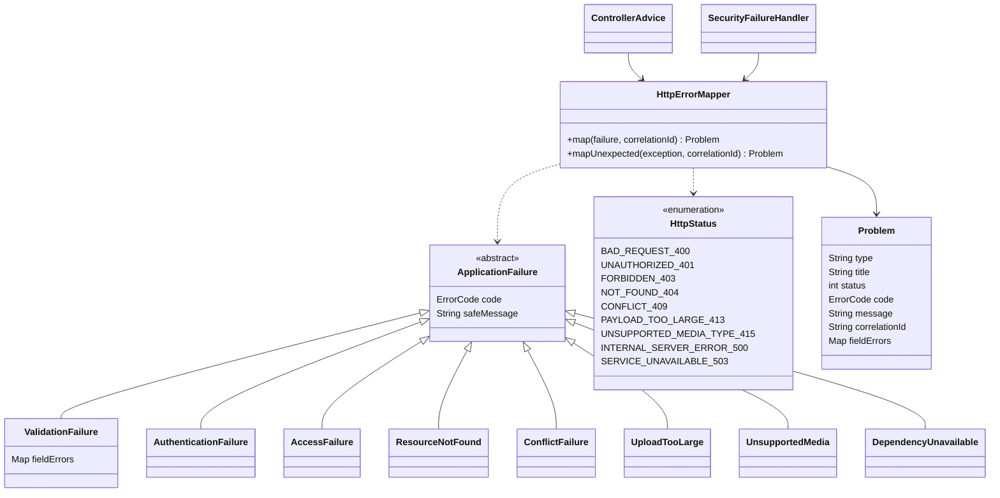

# Exceptional Errors and HTTP Status Codes

The domain/application layers expose typed failures without HTTP dependencies. The inbound adapter maps them to the OpenAPI `Problem` DTO. Spring Security failures use the same renderer through an `AuthenticationEntryPoint` and `AccessDeniedHandler`; they may occur before controller advice. Unexpected failures are logged with correlation ID and returned without exception details.

## Class diagram



These are proposed implementation types, not claims that Java classes exist. HTTP parsing/upload failures may be adapter-local exceptions; domain code never imports HTTP status or Spring MVC types. ErrorCode is the closed string enum in `components.schemas.Problem`; each operation's `x-error-codes` narrows which codes can occur.

## Mapping

| Failure type | HTTP | Stable codes | Required behavior |
| --- | --- | --- | --- |
| ValidationFailure | 400 | `INVALID_REQUEST`, `INVALID_CURSOR`, `UNSAFE_IMAGE` | No write; field errors contain safe request paths, never rejected secrets |
| AuthenticationFailure | 401 | `AUTHENTICATION_REQUIRED`, `INVALID_CREDENTIALS` | Bearer challenge; generic credential message; no account-existence detail |
| AccessFailure | 403 | `ROLE_DENIED`, `ORIGIN_DENIED`, `SELLER_INACTIVE` | Role check before lookup; shop-state denial only for authenticated own catalog writes |
| ResourceNotFound | 404 | `RESOURCE_NOT_FOUND` | Missing and foreign IDs have identical external response |
| ConflictFailure | 409 | `STALE_VERSION`, `CART_CHANGED`, `EMPTY_CART`, `ITEM_UNAVAILABLE`, `STOCK_UNAVAILABLE`, `VOUCHER_INVALID`, `IDEMPOTENCY_CONFLICT`, `ILLEGAL_ORDER_STATE`, `REVIEW_NOT_ELIGIBLE`, `REVIEW_ALREADY_EXISTS`, `LOGIN_ALREADY_EXISTS`, `SKU_ALREADY_EXISTS`, `IMAGE_LIMIT_EXCEEDED` | Roll back command; never partially write stock/order/audit |
| UploadTooLarge | 413 | `PAYLOAD_TOO_LARGE` | Reject oversized multipart input before buffering/decoding it |
| UnsupportedMedia | 415 | `UNSUPPORTED_MEDIA_TYPE` | Reject unsupported JSON/multipart/image MIME |
| Unexpected exception | 500 | `INTERNAL_ERROR` | Generic message; log cause with correlation ID; never return SQL/stack trace |
| DependencyUnavailable | 503 | `SERVICE_UNAVAILABLE` | Database outage/transient exhaustion does not report successful commit |

A lost connection at commit can leave the outcome unknown. Return 503; the caller retries checkout with the **same** key/body, then the persisted idempotency record resolves the outcome. Payment retries can return 409 if the previous attempt committed; read the owned portion to establish state. Do not translate every database constraint to 409: map only known constraints, and let unexpected constraints remain 500.

## Payload and verification

Return `Content-Type: application/problem+json`. `type` is `about:blank`; `title` names the HTTP failure class; `status` equals the actual response status. Clients branch on stable `code`, never on message text. Correlation ID is generated by the server or accepted only after bounded validation. `fieldErrors` is optional and is an object from request field path to safe message.

```json
{
  "type": "about:blank",
  "title": "Conflict",
  "status": 409,
  "code": "STALE_VERSION",
  "message": "The resource changed. Reload it before editing.",
  "correlationId": "request-7cba"
}
```

Before implementation, create scenario tests for each applicable operation/status/code, then verify exact status, MIME and schema. Cover controller validation, security filter failures, malformed multipart, ownership before version, duplicate/illegal state and database outage. Prove rollback and absence of sensitive fields. The [test-first template](../backend/4.%20Automated%20Testing/4.%20Automated%20Testing.md) records these checks; parsing this class diagram alone does not prove runtime behavior.
