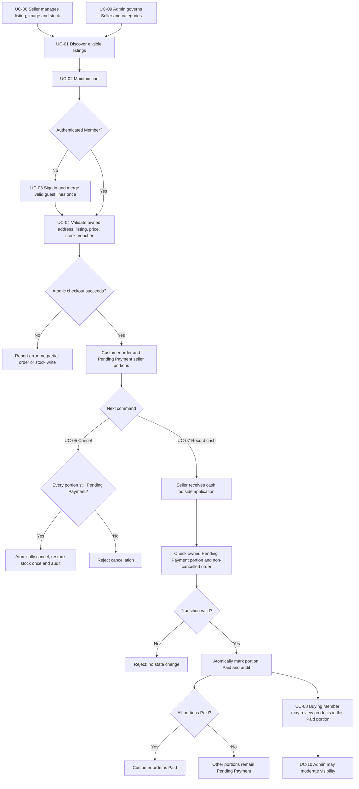

# Domain Discovery

Status: Approved target design. Structure follows [roadmap section 1.1.1](inkdrop://note/uUXxpSnh), revision 23, read through MCP on 2026-11-05.

## Business Glossary

Status: Approved strategic design. Source: [roadmap, section 1.1.1](inkdrop://note/uUXxpSnh), read through MCP on 2026-11-05. Business Analyst remains authoritative for product meaning.

| Term group | Authoritative definition | Use cases |
| --- | --- | --- |
| Guest, Member, Seller, Marketplace Admin | [Four roles](../../../../BusinessAnalyst/product-scope.md#four-roles) | UC-01–UC-10 |
| Customer order, seller portion, COD, Paid | [D2–D3](../../../../BusinessAnalyst/product-scope.md#confirmed-product-choices-and-retained-assumption) | UC-04, UC-07 |
| USD price, snapshot, available stock, idempotency key, voucher | [BR-02–BR-04 and BR-07](../../../../BusinessAnalyst/business-rules.md#invariants) | UC-04–UC-06 |
| Rating, review, visible review | [BR-10 and ratings flow](../../../../BusinessAnalyst/business-rules.md) | UC-01, UC-08, UC-10 |
| LINK, UPLOAD, placeholder | [D6](../../../../BusinessAnalyst/product-scope.md#confirmed-product-choices-and-retained-assumption), [BR-11](../../../../BusinessAnalyst/business-rules.md#invariants) | UC-01, UC-06 |

### Design distinctions

These terms clarify boundaries; they add no product capability.

| Term | Meaning in this design | Trace |
| --- | --- | --- |
| Purchase eligibility | Current listing publication and Seller activation checks at checkout; cart inclusion is not evidence of eligibility. | UC-02, UC-04; BR-01 |
| Paid-purchase evidence | Member/product match against a Paid seller portion, independent of the other portions' status. | UC-08; D8 |
| COD recording | Seller declaration of cash received outside the system. It does not process or transfer money. | UC-07; D3–D4 |
| Governance command | Admin request routed to the context that owns the affected state, with an audit reason. | UC-09, UC-10 |

Context-specific meanings are in [Ubiquitous Language Glossary](./1.1.3-bounded-context-design.md#ubiquitous-language-glossary).

## Business Rules Catalog

The [BA rules](../../../../BusinessAnalyst/business-rules.md) remain the normative catalog. This index allocates enforcement without copying the rules. Contexts below are approved in [the context map](./1.1.3-bounded-context-design.md#bounded-context-map).

| Rule | Enforcement owner | Collaborators | Use cases |
| --- | --- | --- | --- |
| BR-01 | Catalog | Identity and Seller; Ordering rechecks at commit | UC-01, UC-04, UC-09 |
| BR-02 | Ordering | Catalog supplies prices; Promotion supplies discount | UC-04 |
| BR-03 | Inventory | Ordering owns transaction | UC-04, UC-05, UC-06 |
| BR-04 | Ordering | Unique Member/key constraint | UC-04 |
| BR-05 | Each Seller-facing context | Identity supplies actor; owner checks stay local | UC-06, UC-07 |
| BR-06 | Cart, Ordering, Reviews, Identity and Seller | Actor and resource ownership | UC-02, UC-04, UC-05, UC-08 |
| BR-07 | Promotion | Ordering owns transaction | UC-04 |
| BR-08 | Ordering | COD application service; Audit | UC-07 |
| BR-09 | Ordering | Inventory; Audit | UC-05 |
| BR-10 | Reviews | Ordering supplies paid-purchase evidence | UC-08, UC-10 |
| BR-11 | Catalog | Approved remote image host; PostgreSQL | UC-01, UC-06 |

### Source decisions and scope

| Issue | Source evidence | Approved handling / scope |
| --- | --- | --- |
| Admin payment correction | [Admin capabilities](../../../../BusinessAnalyst/product-scope.md#four-roles) previously mentioned corrections; [BR-08/BR-09](../../../../BusinessAnalyst/business-rules.md#invariants) define one-way payment and no reversal. No correction use case is defined. | Excluded from the current UC/API baseline; no correction or reversal command. A future change needs a new use case and contract. |
| Deleted review and resubmission | BR-10 permits one active review, while the [data model](../../2-application-architecture/2.1-persistence-architecture/2.1.1-persistence-diagram.md#database-schema-diagram) now specifies partial active Member/product uniqueness. | The current HTTP contract uses a tombstone and permits eligible resubmission. Partial uniqueness covers only active reviews; Reviews owns enforcement. |

Acceptance scenarios remain in [user stories](../../../../BusinessAnalyst/user-stories.md). Verification of boundary behavior is recorded in the [integration contract](./1.1.3-bounded-context-design.md#preliminary-integration-contract).

## Business Process Diagram

This Mermaid diagram links the existing [BA flows](../../../../BusinessAnalyst/business-rules.md#main-flows) across use cases. Detailed decisions remain in the [activity sources](../../../../BusinessAnalyst/activity-diagrams.md) and [COD BPMN](../../../../BusinessAnalyst/bpmn-process.md).

Concurrent payment and cancellation must serialize against the same customer order. Image failures use the BA placeholder path and do not enter checkout failure handling. A retry with the same checkout key/payload returns the original order; it does not traverse a second stock decrement (BR-04).
