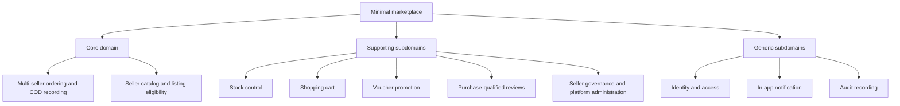

# Domain Decomposition

Status: proposed target design. Structure follows [roadmap section 1.1.2](inkdrop://note/uUXxpSnh), revision 23, read through MCP on 2026-11-05.

## Domain Decomposition Diagram

Status: proposed classification for the current minimal marketplace, not a deployment plan. Importance and traceability are in the [subdomain catalog](./1.1.2-domain-decomposition.md#subdomain-catalog).

Core classification reflects the proposed product focus: eligible multi-Seller listings and independently recorded COD portions. It is not a claim of measured market differentiation. Stock is supporting but transaction-critical. Generic classification does not authorize an external provider; the [excluded scope](../../../../BusinessAnalyst/product-scope.md#excluded) still applies.

## Subdomain Catalog

Status: proposed. P1 blocks a purchase or trust boundary; P2 supports the specified product but is outside the atomic purchase decision. These are design priorities, not release scope cuts. All included BA capabilities remain required.

| Subdomain | Class / importance | Responsibility and project reason | Use cases / sources |
| --- | --- | --- | --- |
| Multi-seller ordering and COD | Core / P1 | Split checkout, snapshots, unpaid cancellation and per-Seller cash receipt form the marketplace transaction. | UC-04, UC-05, UC-07; D2–D5, BR-02/04/08/09 |
| Seller catalog | Core / P1 | Seller-owned offerings, variants and publication define what can be bought. Images belong to offerings. | UC-01, UC-06, UC-09; BR-01/05/11 |
| Stock control | Supporting / P1 | Protect quantities across concurrent checkout, cancellation and Seller updates. | UC-04–UC-06; BR-03 |
| Shopping cart | Supporting / P1 | Retain purchase intent and merge Guest intent after login; no price or stock guarantee. | UC-02, UC-03; BA main flows |
| Voucher promotion | Supporting / P1 | Validate and consume discount eligibility within checkout. | UC-04; BR-07 |
| Purchase-qualified reviews | Supporting / P2 | Gate feedback by a Paid portion and expose visible-only summaries. | UC-01, UC-08, UC-10; BR-10 |
| Seller governance and administration | Supporting / P1 | Control active Sellers, shared categories, moderation and reports. | UC-09, UC-10; D9 |
| Identity and access | Generic / P1 | Authenticate four roles, enforce one role per account and supply actor identity. | UC-03 and all protected cases; D1/D9 |
| In-app notification | Generic / P2 | Store user-visible messages in PostgreSQL only. | D7; no dedicated BA use case yet |
| Audit recording | Generic / P1 | Preserve actor/time/reason for governed mutations in their transaction. | UC-04, UC-05, UC-07, UC-09, UC-10 |

Definitions and rule text: [scope](../../../../BusinessAnalyst/product-scope.md), [rules](../../../../BusinessAnalyst/business-rules.md), [use cases](../../../../BusinessAnalyst/use-cases.md). Notification triggers, recipients and read lifecycle need BA acceptance criteria before new behavior is implemented.
