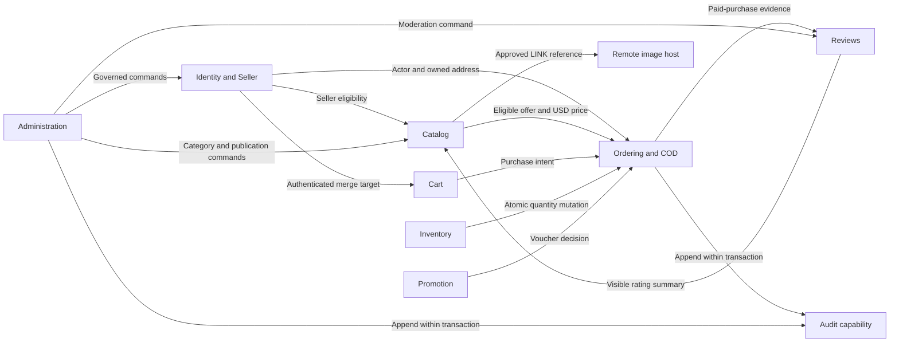
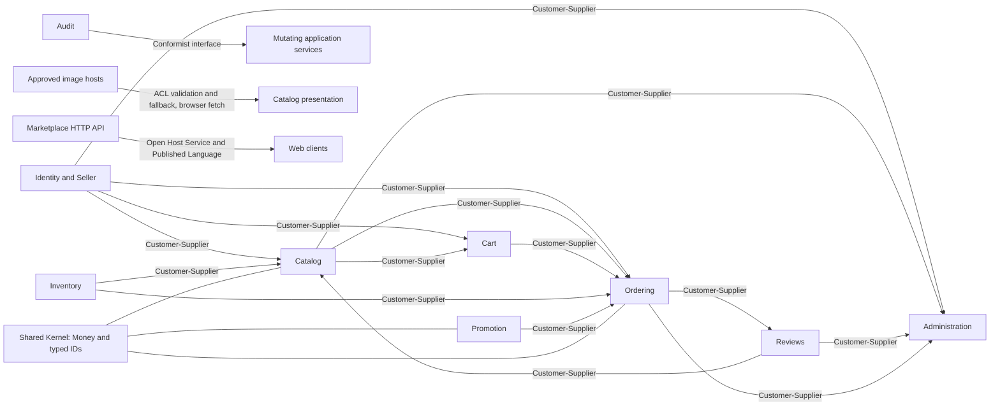

# Bounded Context Design

Status: proposed target design. Structure follows [roadmap section 1.1.3](inkdrop://note/uUXxpSnh), revision 23, read through MCP on 2026-11-05.

## Bounded Context Map

Status: proposed logical boundaries within the single Spring Boot deployable. All contexts persist in PostgreSQL. A context is not a microservice or mandatory build module.



Business-data arrows run provider to consumer, except explicitly labeled command/append arrows. Relationship patterns and all dependencies are in the [matrix](./1.1.3-bounded-context-design.md#context-relationship-matrix).

| Context | Owned model / writes |
| --- | --- |
| Identity and Seller | Account, role, Seller activation, shop identity, Member address |
| Catalog | Category, product, variant, USD price, image and publication |
| Inventory | Variant quantity and version |
| Cart | Guest/Member intent and merge consumption |
| Ordering and COD | Customer order, seller portions, snapshots, cancellation and COD state |
| Promotion | Voucher policy and redemption |
| Reviews | Rating, text and visibility |
| Administration | Governance orchestration and bounded report queries; no duplicated domain state |

Audit and notification are shared application capabilities, with private persistence adapters; they do not share domain entities between contexts. Notification has no proposed trigger until BA defines it.

### Boundary decisions

```text
boundary Ordering:                         // UC-05, UC-07
  CustomerOrder owns SellerOrder payment transitions and cancellation
  prohibit independent payment-state owner
boundary IdentityAndSeller:               // UC-09
  owns Shop identity and activation
boundary Catalog:                         // UC-01, UC-06
  owns offerings; consumes Seller eligibility by ID
sharedKernel = {MoneyUSD, typed opaque IDs}
  require joint review for semantic changes
  prohibit shared mutable domain entities
Administration -> owner.applicationCommand(actor, reason)  // UC-09, UC-10
Administration -> readOnlyReport(boundedDateRange)
LINK display -> approved remote host via browser           // UC-01, UC-06
  validate URL and metadata; use placeholder on failure
  never make image availability a checkout dependency
```

## Context Relationship Matrix

Status: proposed. Upstream supplies the model or service that downstream uses; a command's call direction can be the reverse. Internal contracts are synchronous application calls in one deployable.

| Upstream | Downstream | Pattern | Boundary / use cases |
| --- | --- | --- | --- |
| Identity and Seller | Catalog | Customer–Supplier | Active Seller evidence; UC-01, UC-06, UC-09 |
| Identity and Seller | Cart, Ordering | Customer–Supplier | Actor, merge target and owned address; UC-02–UC-05 |
| Catalog | Cart | Customer–Supplier | Current variant availability for cart display; UC-02 |
| Catalog | Ordering | Customer–Supplier | Current purchasable offer and price; UC-04 |
| Cart | Ordering | Customer–Supplier | Owned purchase intent; UC-04; never authoritative totals |
| Inventory | Ordering | Customer–Supplier | Decrement/restore under caller transaction; UC-04, UC-05 |
| Inventory | Catalog | Customer–Supplier | Stock display and Seller stock command; UC-01, UC-06 |
| Promotion | Ordering | Customer–Supplier | Voucher validation/redemption in transaction; UC-04 |
| Ordering | Reviews | Customer–Supplier | Member/product paid-purchase evidence; UC-08 |
| Reviews | Catalog discovery | Customer–Supplier | Visible rating/count read model; UC-01 |
| Identity, Catalog, Reviews, Ordering | Administration | Customer–Supplier | Owned governance services and bounded report data; UC-09, UC-10; correction unresolved |
| Audit capability | Mutating application services | Conformist | Adopt append-only actor/time/reason interface; UC-04–UC-10 where audited |
| Approved image hosts | Catalog image presentation | Anti-Corruption Layer | Validate remote URL/metadata and isolate unavailable media behind placeholder; UC-01, UC-06 |
| Marketplace HTTP API | Web clients | Open Host Service + Published Language | OpenAPI schemas and stable errors; UC-01–UC-10 |



## Ubiquitous Language Glossary

Status: proposed context language. Existing business definitions are linked in the [business glossary](./1.1.1-domain-discovery.md#business-glossary).

| Ambiguous keyword | Meanings across contexts | Required contract name / trace |
| --- | --- | --- |
| Order / Paid | Ordering coordinates all portions; Seller operations address one portion. Review eligibility needs only the purchased portion Paid. | `customerOrderId`, `sellerOrderId`, `paidPurchaseEvidence`; UC-04/07/08 |
| Product / price | Catalog has a mutable offer/current price; Cart has intent/estimate; Ordering has immutable purchased description/price. | `currentOffer`, `cartEstimate`, `purchasedLineSnapshot`; UC-01/02/04 |
| Available | Catalog means published and Seller active; Inventory means sufficient units; Cart inclusion guarantees neither. | `listingEligible`, `onHand`, `requestedQuantity`; UC-02/04/06 |
| Seller | Identity owns activation and shop identity; Catalog uses listing owner; Ordering uses portion owner and historical snapshot. | `sellerEligibility`, `productOwnerId`, `portionSellerId`; UC-06/07/09 |
| Discount / redemption | Promotion evaluates a current rule and consumes quota; Cart may display an estimate; Ordering retains the final allocated discount. | `voucherDecision`, `redemption`, `discountSnapshot`; UC-04 |
| Visible / active | Seller activation governs new purchases; Product publication governs offerings; Review visibility governs public feedback only. | `sellerStatus`, `publicationState`, `reviewVisible`; UC-01/09/10 |

## Preliminary Integration Contract

Status: proposed internal contracts for section 1.1.3. Names below describe application operations, not new HTTP endpoints. [OpenAPI](../../../api-contract/openapi.yaml) remains authoritative for HTTP fields, paths and errors. No event broker, outbox or distributed transaction is introduced.

### Request and result boundaries

Every protected command receives a server-derived actor context (account ID, operational role and correlation ID). Resource owners are checked by the receiving context; clients cannot assert ownership. IDs are opaque and money uses exact USD decimals. Mutable entities do not cross boundaries.

| Operation / provider | Input | Result / failure | Trace |
| --- | --- | --- | --- |
| Resolve actor/address / Identity | Authenticated actor; address ID where needed | Valid role and owned address snapshot; reject missing/non-owned address | UC-03, UC-04; BR-06 |
| Merge cart / Cart | Guest session, authenticated Member | Merge valid lines once; report unavailable lines; no stock reservation | UC-02, UC-03 |
| Read purchasable offers / Catalog | Variant IDs and quantities | Seller/product/variant IDs, current publication/activation and USD price; reject ineligible lines | UC-04; BR-01/02 |
| Decrease stock / Inventory | Validated variant quantities | Conditional quantity changes under caller transaction; insufficient quantity aborts all | UC-04; BR-03 |
| Evaluate and redeem / Promotion | Voucher, Member, validated purchase lines | Discount snapshot and redemption in checkout transaction; invalid/over-limit aborts all | UC-04; BR-07 |
| Place order / Ordering | Owned cart intent, address, optional voucher, Member-scoped key and request fingerprint | Customer order and seller portions; same key/payload returns original, changed payload conflicts | UC-04; BR-02/04 |
| Cancel order / Ordering | Member, customerOrderId | Cancel and restore stock once only if every portion remains pending | UC-05; BR-09 |
| Record COD / Ordering | Seller, sellerOrderId | Pending-to-Paid transition plus audit; reject cancelled, already Paid or non-owned portion | UC-07; BR-05/08 |
| Check paid purchase / Ordering | Member ID, product ID | Boolean eligibility derived from owned Paid portion; no other buyer/order data exposed | UC-08; BR-10 |
| Submit/moderate review / Reviews | Member/product/rating/text or Admin/review/visibility/reason | Enforce eligibility and uniqueness; moderation updates public summary | UC-08, UC-10 |
| Append audit / Audit | Actor, action, resource, timestamp, correlation ID, reason where required | Append in mutation transaction; audit failure aborts mutation | UC-04, UC-05, UC-07, UC-09, UC-10 |

### Consistency and failures

Ordering owns the PostgreSQL checkout transaction across offer validation, stock, voucher redemption, snapshots, seller portions, idempotency and audit. Collaborators join it and must not commit independently. Acquire stock rows in stable variant order. Protect Seller/listing eligibility and voucher limits against concurrent changes before commit; select a lock/version strategy during tactical design and verify it with race tests.

Cancellation and COD recording lock or conditionally version the same customer-order coordination record before checking portions. This serializes the race: cancellation first blocks later payment; payment first blocks cancellation. Inventory restoration commits with cancellation and audit. Retry cannot restore twice.

A timeout after commit has an unknown client outcome. Checkout retries reuse the original key and fingerprint. COD repeat transitions remain conflicts under BR-08; clients read the current portion before deciding what to show. No retry fabricates a successful write after a database failure.

HTTP translation follows [BA failure behavior](../../../../BusinessAnalyst/business-rules.md#failure-behavior-and-acceptance): 400 input, 401 authentication, 403 role, 404 missing/non-owned resource, 409 conflicts where specified. Use the existing stable error vocabulary; tactical design must reconcile any missing machine code with OpenAPI before implementation.

### Verification obligations

| Scenario | Required observation |
| --- | --- |
| UC-04: two buyers compete for last unit | One commit; other request leaves no partial order, redemption or audit success record. |
| UC-04: concurrent identical key | One order and one stock decrement; changed payload conflicts. |
| UC-05 / UC-07: cancel versus mark-paid | One valid outcome; no Paid order with restored stock. |
| UC-07: wrong Seller or duplicate transition | No changed state or leaked foreign order data. |
| UC-08: one paid portion, another pending | Purchased products in the paid portion qualify; other products do not. |
| UC-10: hide a review | Public count/average exclude it on subsequent reads. |
| UC-01 / UC-06: LINK source unavailable | Local placeholder; discovery and purchase controls remain usable. |
| Audited mutation: audit persistence fails | Entire governed mutation rolls back. |

These are required checks for implementation, not test results from this documentation task.

### Open decisions

| Decision | Owner to confirm | Implementation boundary |
| --- | --- | --- |
| Voucher quota restoration on unpaid cancellation | Product owner / BA | Do not infer restoration or permanent consumption from BR-07. |
| Admin payment correction and review resubmission | Product owner / BA | Resolve [source conflicts](./1.1.1-domain-discovery.md#unresolved-source-conflicts). |
| Notification triggers and delivery/read semantics | Product owner / BA | No new notification side effects in these contracts. |
| Stable request/result schemas | Solution architect | Use the context ownership above; reconcile tactical types with HTTP contracts. |

Module API DTO conversion uses adapter-local [MapStruct mappings](../../3-technical-decision/3.14-mapstruct.md). Mappers exchange immutable facts and never expose another context’s mutable aggregate.
