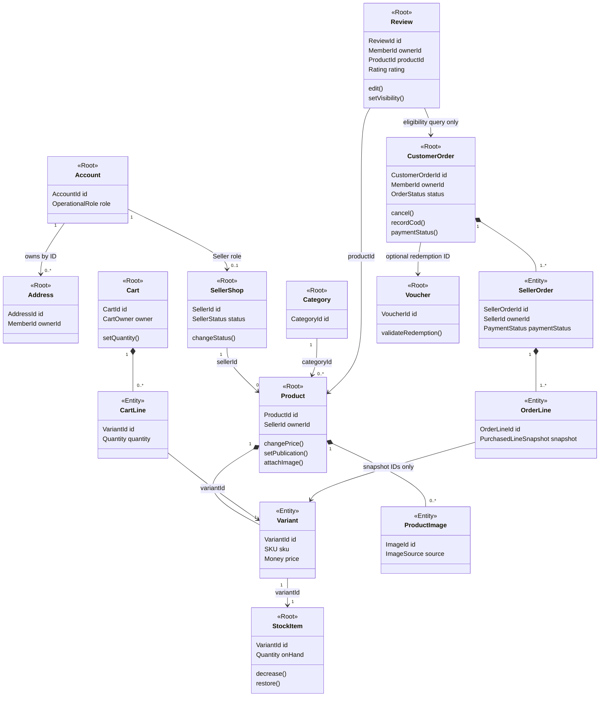

# Domain Model Design

Status: proposed target design for [roadmap 1.2.1](inkdrop://note/uUXxpSnh), revision 23, read through MCP on 2026-11-05. This document defines model boundaries, not implemented classes. [Strategic ownership](../1.1-strategic-design/1.1.3-bounded-context-design.md#bounded-context-map), [BA use cases](../../../../BusinessAnalyst/use-cases.md) and [BA rules](../../../../BusinessAnalyst/business-rules.md) remain the traceability baseline.

## Domain Model Diagram

Composition denotes membership in one aggregate. Other associations carry IDs or immutable evidence across aggregate boundaries; they do not permit writes through object navigation. Every class marked `Root` is an aggregate root. Technical persistence records are omitted.



The Product minimum of one variant is a proposed publish/checkout condition; a creation workflow may build an unpublished product before its first variant. Seller-order lines stay available after catalog edits. The eligibility association does not store a mutable Order inside Review.

## Aggregate Design Document

### Identity and Seller

Trace: UC-03/04/09.

| Concept | Design |
| --- | --- |
| Entity | Account, Address, SellerShop |
| Value Object | AccountId, MemberId, SellerId, AddressValue, OperationalRole |
| Aggregate | Account / Address / SellerShop independently |
| Aggregate Root | Account; Address; SellerShop |
| Invariant | One role; unique login; owned address; governed Seller activation |
| Factory | Account.register; Address.create; SellerShop.create |

```text
root Account(id: AccountId, login: NormalizedLogin, role: OperationalRole)
root Address(id: AddressId, owner: MemberId, value: AddressValue)
root SellerShop(id: SellerId, accountId: AccountId, status: SellerStatus)
account = Account.register(id, normalizedLogin, passwordHash, role)
address = Address.create(addressId, memberId, AddressValue(fields))
shop = SellerShop.create(sellerId, account.id, approvedInitialStatus)
```

### Catalog

Trace: UC-01/06/09.

| Concept | Design |
| --- | --- |
| Entity | Category, Product, Variant, ProductImage |
| Value Object | SKU, MoneyUSD, ImageSource |
| Aggregate | Product owns Variant and ProductImage; Category is separate |
| Aggregate Root | Product; Category |
| Invariant | Owner-only writes; valid image source; valid priced variant before publication |
| Factory | Product.create; ProductImageFactory.create |

```text
root Category(id: CategoryId, name: Text)
root Product(id: ProductId, owner: SellerId, variants: List<Variant>, images: List<ProductImage>)
entity Variant(id: VariantId, sku: SKU, price: MoneyUSD)
entity ProductImage(id: ImageId, source: ImageSource)
value ImageSource = Link(approvedUrl, source, license) | Upload(validatedContent)
product = Product.create(productId, sellerId, categoryId)
product.addVariant(Variant(id, SKU(sku), MoneyUSD(price)))
product.attachImage(ProductImageFactory.create(validatedSource))
```

### Inventory

Trace: UC-04/05/06.

| Concept | Design |
| --- | --- |
| Entity | StockItem |
| Value Object | Quantity, VariantId |
| Aggregate | StockItem per VariantId |
| Aggregate Root | StockItem |
| Invariant | onHand >= 0; decrement and restore serialize |
| Factory | StockItem.create |

```text
root StockItem(id: VariantId, onHand: Quantity, version: Version)
stock = StockItem.create(variantId, Quantity.nonnegative(initial))
stock.decrease(Quantity.positive(requested))
```

### Cart

Trace: UC-02/03.

| Concept | Design |
| --- | --- |
| Entity | Cart, CartLine |
| Value Object | CartOwner, Quantity |
| Aggregate | Cart owns lines keyed by VariantId |
| Aggregate Root | Cart |
| Invariant | Exactly one owner; one line per variant; consume Guest merge once |
| Factory | Cart.forGuest; Cart.forMember |

```text
root Cart(id: CartId, owner: CartOwner, lines: Map<VariantId, CartLine>)
entity CartLine(variantId: VariantId, quantity: PositiveQuantity)
value CartOwner = Guest(sessionIdentity) | Member(memberId)
cart = Cart.forMember(cartId, memberId)
cart.setQuantity(variantId, Quantity.positive(quantity))
```

### Ordering and COD

Trace: UC-04/05/07.

| Concept | Design |
| --- | --- |
| Entity | CustomerOrder, SellerOrder, OrderLine |
| Value Object | AddressSnapshot, PurchasedLineSnapshot, MoneyUSD, CheckoutFingerprint |
| Aggregate | CustomerOrder owns portions and lines |
| Aggregate Root | CustomerOrder |
| Invariant | All portions pending for cancel; Paid iff all portions Paid; immutable snapshots |
| Factory | OrderFactory.place |

```text
root CustomerOrder(id: CustomerOrderId, memberId: MemberId, portions: List<SellerOrder>)
entity SellerOrder(id: SellerOrderId, sellerId: SellerId, lines: List<OrderLine>, paymentStatus)
entity OrderLine(id: OrderLineId, immutable snapshot: PurchasedLineSnapshot)
order = OrderFactory.place(validatedLines, addressSnapshot, allocation, memberId)
order.recordCod(sellerOrderId, authenticatedSellerId, now)
// root checks owner, PLACED and PENDING_PAYMENT before mutation
```

### Promotion

Trace: UC-04.

| Concept | Design |
| --- | --- |
| Entity | Voucher; redemption ledger record |
| Value Object | ValidityWindow, EligibilityRule, DiscountRule |
| Aggregate | Voucher controls usage; ledger is not an unbounded child collection |
| Aggregate Root | Voucher |
| Invariant | Eligibility and usage limit checked under lock; no failed-checkout consumption |
| Factory | Voucher.define |

```text
root Voucher(id: VoucherId, validity: ValidityWindow, eligibility: EligibilityRule, discount: DiscountRule)
voucher = Voucher.define(id, code, validity, eligibility, discount, limit)
decision = voucher.validateRedemption(purchaseFacts, lockedUsage, now)
```

### Reviews

Trace: UC-08/10.

| Concept | Design |
| --- | --- |
| Entity | Review |
| Value Object | Rating, ReviewText, PaidPurchaseEvidence |
| Aggregate | Review per Member/product |
| Aggregate Root | Review |
| Invariant | Paid-purchase eligibility; one active review; rating 1–5 |
| Factory | Review.create |

```text
root Review(id: ReviewId, memberId: MemberId, productId: ProductId, rating: Rating, visible: Boolean)
value Rating(integer): require 1 <= integer <= 5
review = Review.create(id, memberId, productId, Rating(stars), text, evidence)
review.setVisibility(adminActor, visible, reason)
```

### Administration

Trace: UC-09/10.

| Concept | Design |
| --- | --- |
| Entity | No independent domain entity |
| Value Object | ActorContext, Reason, DateRange |
| Aggregate | No domain aggregate; delegates to owners |
| Aggregate Root | None |
| Invariant | Admin authorization; reason and append-only audit |
| Factory | No domain factory |

```text
service Administration(ownerCommands, reportQueries)
admin = Administration(ownerCommands, reportQueries)
admin.changeSellerStatus(actor, sellerId, status, reason)
```

Administration orchestrates these roots and reads reports; it does not own copies of their states. Audit entries are append-only records, not mutable aggregates. Notification records remain a supporting capability pending [BA decisions](../1.1-strategic-design/1.1.3-bounded-context-design.md#open-decisions).

SellerOrder is an entity inside CustomerOrder. It has no independent write repository. A Seller-facing query returns only that Seller's portion, while a payment command loads the coordinating root internally and checks the portion owner. This makes the cancel-versus-payment invariant explicit without exposing other Sellers' details.

Cross-aggregate transactions are intentional in this single-database target: checkout includes stock and voucher consumption; cancellation includes stock restoration. Splitting those actions into eventual consistency would violate BR-03/07/09. One customer-order row coordinates later payment/cancellation, avoiding locks on unrelated orders. Large carts increase that transaction's lock set; cart/checkout size limits remain a product/API decision, not an invented numeric limit here.

### Value objects and factories

| Value object | Construction rule / use |
| --- | --- |
| Money | Exact decimal USD with two fractional digits, within the existing database range. Prices, discounts and totals are nonnegative; discounts cannot exceed their applicable gross amount. No floating-point arithmetic. |
| Quantity / Rating | Positive cart/order quantity; stock may be zero. Rating is an integer from 1 through 5. |
| Typed IDs / SKU | IDs distinguish account, product, variant, customer order and seller order. SKU uniqueness is enforced by the existing data-model constraint. |
| CartOwner | Exactly one of Guest session identity or Member ID. Guest proof comes from the opaque session cookie. |
| ImageSource | Tagged LINK or UPLOAD value. LINK holds approved HTTPS URL/source/license metadata and no bytes; UPLOAD holds validated image metadata/content reference and no remote URL. Bytes stay in PostgreSQL. |
| PurchasedLineSnapshot | Product/variant/Seller identifiers, purchased description, quantity, USD unit price, allocated discount and line total; immutable after placement. |
| AddressSnapshot | Copy of the selected Member-owned address at checkout; later address changes do not change the order. |
| CheckoutFingerprint | Canonical representation of the accepted checkout intent, excluding computed totals and volatile timestamps. Persist it with Member/key for replay checks. |
| PaidPurchaseEvidence | Immutable answer scoped to Member/product from Ordering; only the server can construct it. It is not client-supplied proof. |

`OrderFactory.place(validatedLines, addressSnapshot, discountAllocation, memberId)` groups lines by Seller, creates nonempty portions in `PENDING_PAYMENT`, calculates totals and returns a `PLACED` root. It cannot query repositories or commit. The application supplies validated, transaction-protected inputs. Order total equals the sum of portion totals, each equal to its lines after discounts.

`ProductImageFactory` constructs the selected ImageSource only after the existing [image contract](../../../api-contract/product-images.md) checks succeed. `Review.create` requires paid-purchase evidence and a valid Rating; its repository/constraint resolves concurrent duplicate creation. Simple Account, Cart and StockItem creation uses named constructors rather than extra factory classes.

Percentage-voucher rounding and allocation across seller portions are not specified in BA. Proposed default: compute in cents, allocate a final discount proportionally by gross line amount, and assign remainder cents by stable variant ID without exceeding a line gross amount. Product owner approval is required before making this algorithm normative; tactical implementation must use one policy for snapshots and displayed totals.

## Invariant Catalog and Entity Lifecycle

### Invariant catalog

Rule text remains in [BA BR-01–BR-11](../../../../BusinessAnalyst/business-rules.md#invariants). The table records enforcement and proof obligations.

| Rule | Domain guard / persistent protection | Verification |
| --- | --- | --- |
| BR-01 | PurchaseEligibilityPolicy uses current Product publication and Seller status; hold relevant rows stable during checkout | Suspension/unpublication race produces a valid serial outcome, never a stale eligibility commit |
| BR-02 | OrderFactory and immutable snapshots; Money checks and snapshot columns | Price/address edits after placement leave order values unchanged |
| BR-03 | StockItem checks plus conditional decrement/nonnegative constraint, all lines in one transaction | Two buyers race for last unit; only one decrements |
| BR-04 | Member/key unique constraint plus stored fingerprint | Concurrent same-key requests return one order; changed payload conflicts |
| BR-05/06 | Root ownership checks and owner-filtered queries from trusted actor | Foreign IDs return 404; wrong roles are rejected before mutation |
| BR-07 | Voucher policy, locked usage/limit decision and redemption uniqueness per checkout | Concurrent last redemption has one winner; rejected checkout consumes nothing |
| BR-08 | CustomerOrder.recordCod checks its state, portion owner and pending status under root lock | Duplicate and foreign transitions fail; last payment derives Paid |
| BR-09 | CustomerOrder.cancel checks all portions under same lock; restore stock and audit in same transaction | Payment/cancellation race cannot both succeed; repeated cancel cannot restore twice |
| BR-10 | Rating and eligibility policy; unique Member/product constraint and owner-checked mutations | Unpaid/non-buyer rejected; hidden reviews excluded from aggregate |
| BR-11 | ImageSource construction plus source/type/size checks | Unsafe input is rejected; unavailable display uses placeholder |

### Entity lifecycle

| Entity / root | Creation and changes | End or retention rule |
| --- | --- | --- |
| Account / Address | Register or create owned address; permitted own-profile changes | Deletion/retention is not specified; do not cascade into order snapshots |
| SellerShop | Seller identity then governed status changes | ACTIVE/SUSPENDED are the API update values; pre-approval lifecycle remains unspecified |
| Category / Product / Variant | Admin category; Seller offering, price and publication changes | Preserve references/snapshots for existing purchases; archival/deletion policy is not defined here |
| ProductImage | Validated LINK/UPLOAD attachment; removal through owning Product | Removed image cannot leave an invalid mixed source; historical order text/totals remain intact |
| StockItem | Created for a variant, quantity changes on commands | Zero is a valid balance, not deletion; no reservation or expiry state |
| Cart / CartLine | Guest or Member intent; set/remove line; Guest merge consumed once | Guest expiry exists in the data model; TTL and checkout clearing policy need BA definition |
| CustomerOrder / SellerOrder / OrderLine | Factory placement; legal COD transitions; snapshots fixed | Customer order can become CANCELLED only while all portions are pending; Paid is not reversible by Seller |
| Voucher / Redemption | Voucher validation then committed consumption | Expiry invalidates new use; cancellation quota restoration remains unresolved |
| Review | Eligible Member creates, edits/deletes; Admin changes visibility | Deletion representation/resubmission remains unresolved; hiding is not deleting |
| AuditEntry | Append with governed mutation | No update/delete path for Admin; retention policy is outside this design |

Existing unresolved decisions remain in [Strategic Design](../1.1-strategic-design/1.1.1-domain-discovery.md#unresolved-source-conflicts). No lifecycle state here adds shipping, delivery, return or refund behavior.

Factories and invariant-checking constructors remain handwritten. [MapStruct](../../3-technical-decision/3.14-mapstruct.md) may assemble boundary payloads but never creates or mutates a root directly; [Lombok](../../3-technical-decision/3.15-lombok.md) must not generate constructors.
