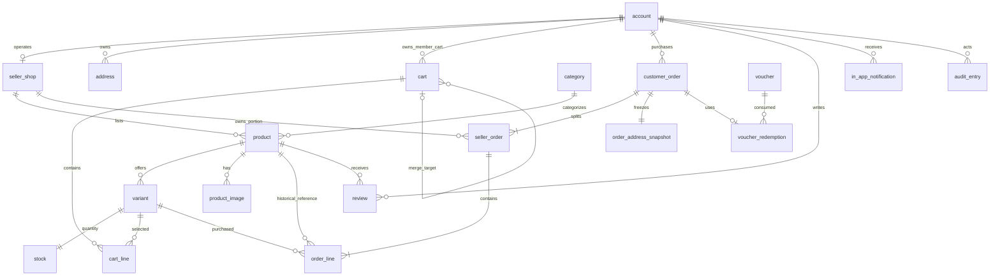
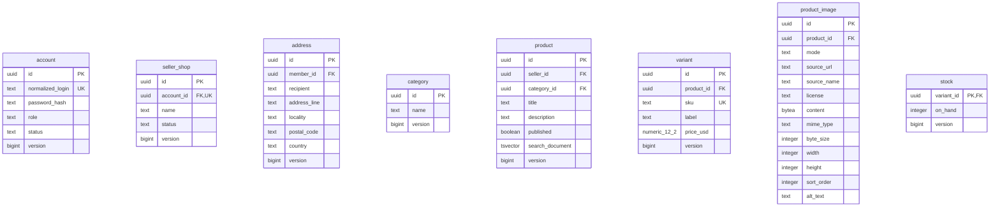
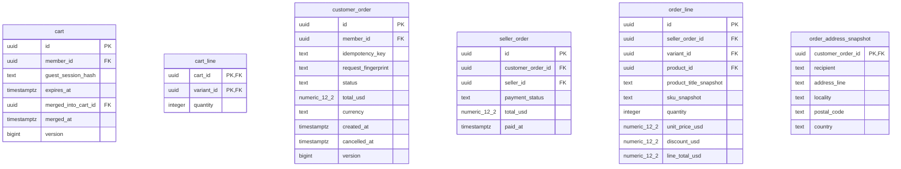
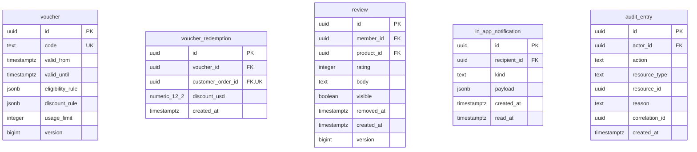

# Persistence Diagram

Status: Approved PostgreSQL target for [roadmap 2.1.1](inkdrop://note/uUXxpSnh), revision 52, read through MCP on 2026-11-07. No SQL migration is generated. [Domain ownership](../../1-domain-driven-design-model/1.1-strategic-design/1.1.3-bounded-context-design.md) and [aggregate invariants](../../1-domain-driven-design-model/1.2-tactical-design/1.2.1-domain-model-design.md#invariant-catalog) govern the design.

## Entity Relationship Diagram

All entities below belong to the single application schema `marketplace`. Contexts own writes through application boundaries, not separate PostgreSQL schemas. UUID keys are an approved storage choice; domain IDs remain opaque. Relationships describe persisted references, not permission to traverse another context's mutable model.

## Database Schema Diagram

`numeric_12_2` denotes PostgreSQL `NUMERIC(12,2)`. PK/FK/UK annotations identify single-column keys; composite uniqueness, nullable fields and cross-row constraints are specified below. Split diagrams share the same `marketplace` schema.

### Identity and offerings

### Cart and ordering

### Promotion, reviews and supporting records

### Constraints and ownership

All fields are NOT NULL except the explicit optional fields below. Referenced identifiers use restrictive deletion by default. Snapshot rows and audit history cannot be erased by deleting an Account, Seller, Product or Variant; archive retained masters instead. Deleting an unreferenced Product may remove its dependent images/variants/stock only in a controlled Catalog operation.

| Area / use cases | Required constraints beyond the diagrams |
| --- | --- |
| Identity; UC-03/09 | Unique normalized login; role is MEMBER, SELLER or ADMIN (Guest has no account). Seller shop account must have Seller role; Member-owned addresses/orders/reviews require Member role. Cross-row role/owner rules are enforced by commands under transaction protection. |
| Catalog; UC-01/06/09 | Global unique SKU; nonnegative price. Category and Seller references required. A published purchasable Product has at least one valid Variant. Product/Variant IDs in an order line must identify the same offer, whose Seller matches its seller portion at placement. |
| Images; UC-01/06 | LINK requires URL/source/license, with content null; UPLOAD requires content and validated MIME/size/dimensions, with URL/source/license null. Metadata not available for LINK may be null. Exactly one branch is valid. Bounds and HTTPS/host checks follow the [image contract](../../../api-contract/product-images.md). Source URL availability is never a database constraint. |
| Stock; UC-04/05/06 | One stock row per purchasable variant; on_hand >= 0. Conditional decrement checks availability. Restore is legal only with a successful cancellation in the same transaction. |
| Cart; UC-02/03 | Exactly one of member_id or guest_session_hash; each nullable. Unique non-null member_id and unique non-null guest_session_hash. Composite PK cart_line(cart_id, variant_id); quantity > 0. Guest expiry required; Member expiry may be null. merged_into_cart_id and merged_at are either both null or both set; target differs from source, source is Guest and target is Member. Lock both carts for one-time merge. |
| Order; UC-04/05/07 | Unique (member_id, idempotency_key); fingerprint required. Status is PLACED or CANCELLED; currency is USD. cancelled_at null iff not cancelled. Unique (customer_order_id, seller_id). Portion payment is PENDING_PAYMENT or PAID; paid_at null iff pending. Derive customer payment status from all portions; do not store a second independently writable status. |
| Snapshots; UC-04 | Exactly one address snapshot and at least one portion/line per order at commit. Positive quantity; all monetary fields nonnegative; line total = quantity × snapshot price − discount. Discount cannot exceed gross. Portion total equals its line totals; customer total equals portion totals. Aggregate factory plus transaction enforces these cross-row sums. |
| Promotion; UC-04 | Unique code; valid_from < valid_until; positive usage_limit (nullable means unlimited). One redemption per customer order. Lock Voucher before counting/adding redemptions. JSON rule fields hold versioned, application-validated rule structures; discount modes and cancellation quota behavior remain BA decisions. |
| Review; UC-08/10 | Unique (member_id, product_id) WHERE removed_at IS NULL; rating 1–5; body optional and bounded by API. removed_at is nullable and records soft removal. Paid-purchase evidence is checked through Ordering. Initial visibility remains an explicit input; hidden stays hidden on edit. Eligible resubmission creates a new active row. Removed rows are excluded from public and active-owner/Admin queries. |
| Notification / audit; D7, UC-04/05/07/09/10 | Notification read_at optional; this retained schema placeholder has no current release trigger/API. Audit reason optional except governed commands that require it. resource_id is a typed logical reference with resource_type, not a polymorphic FK. Runtime audit access permits insert/read only, never update/delete. |

Image MIME/size/width/height are optional for LINK and mandatory for UPLOAD. Product descriptions, variant labels and image alt text can use empty text when allowed by the API; they are not nullable in this approved storage model. Date/time fields use UTC instants stored as `timestamptz`. Snapshot address fields are required strings; validate their content against the current address contract before migration implementation.

### Indexes and transaction guards

| Read/write path | Index or guard | Trace |
| --- | --- | --- |
| Search published offerings | GIN product(search_document); category/publication and Seller lookup indexes; join current Seller status | UC-01 |
| Orders by buyer | customer_order(member_id, created_at, id); unique Member/key lookup | UC-04/05 |
| Seller portions | seller_order(seller_id, payment_status, customer_order_id); parent created_at supports sorting | UC-07 |
| Paid-purchase evidence | order_line(product_id, seller_order_id), seller_order(customer_order_id), customer_order(member_id, id) | UC-08 |
| Public rating summary | review(product_id, visible); aggregate visible rows in PostgreSQL | UC-01/10 |
| Voucher usage | voucher_redemption(voucher_id); lock Voucher row before usage decision | UC-04 |
| Owner reads and joins | Index referencing FK columns unless an existing PK/unique/index prefix already covers them | All protected use cases |
| Audit and notifications | audit_entry(created_at, id), audit_entry(resource_type, resource_id); notification(recipient_id, created_at) | UC-10; D7 |

Checkout atomically commits order snapshots, stock, voucher redemption and audit. Payment and cancellation share a locked customer-order row. The [behavior contract](../../1-domain-driven-design-model/1.2-tactical-design/1.2.2-domain-behavior-design.md#checkout-and-concurrent-mutations) specifies ordering and replay behavior. Cross-row totals, activation races and paid-purchase eligibility are not plain CHECK constraints; verify them with transactional concurrency tests.

Use one migration history and schema-qualified adapter mappings to `marketplace`; do not create per-context schemas or tables in `public`. Report queries use this same database. No separate CQRS store, event table, object store, shipping, refund or payment-gateway table is introduced.
