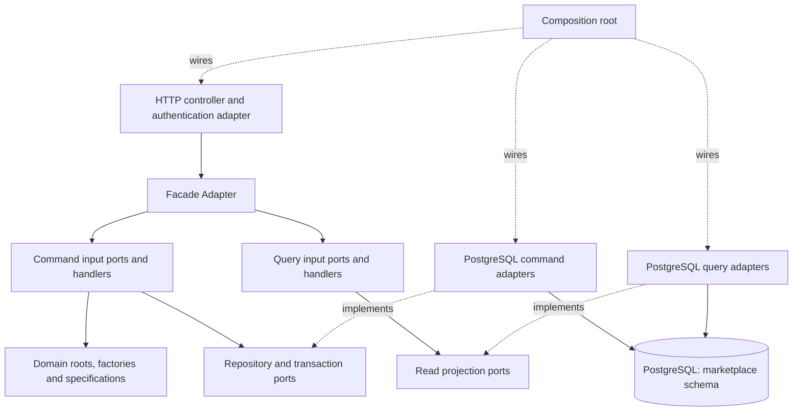

# Application Architecture

Status: Approved design for [roadmap 2.1.2](inkdrop://note/uUXxpSnh), revision 52, read through MCP on 2026-11-07. Clean Architecture and CQRS run inside one Spring Boot deployable against the [single PostgreSQL schema](../2.1-persistence-architecture/2.1.1-persistence-diagram.md). Pseudocode expresses dependencies and behavior, not compilable implementation.

## Clean Architecture and CQRS



Solid arrows show calls; dashed arrows show implementation/wiring dependencies. Domain code imports neither framework nor persistence DTOs. Application handlers depend on domain types and inward-facing ports. Infrastructure implements those ports. The composition root selects adapters; controllers never construct them.

Commands validate invariants and return minimal result DTOs after commit. Queries return immutable projections and cannot save aggregates. CQRS separates code paths and models in the same database; it does not introduce event sourcing, asynchronous projections or a second store. Public reads join current visibility/activation, private reads apply actor ownership in SQL, and Admin reports require bounded date ranges. A completed command is visible to subsequent primary-database queries.

| Use cases | Command path | Query path |
| --- | --- | --- |
| UC-01 | None | Published product/search/category and visible review projections |
| UC-02/03 | EditCart, MergeGuestCart, Register; login through security adapter | OwnCart; identity is returned by login |
| UC-04/05 | PlaceOrder, CancelOrder | OwnOrder with snapshot totals |
| UC-06 | MaintainProduct, AttachImage, ChangeStock | OwnSellerCatalog |
| UC-07 | RecordCodPayment | OwnSellerPortions only |
| UC-08/10 | Create/Edit/DeleteReview, ModerateReview | VisibleReviews, bounded Admin reports/audit |
| UC-09 | ChangeSellerStatus, MaintainCategory | Seller/category administration |

## Adapter Layer

Adapters translate external representations without leaking PostgreSQL rows, ORM entities or HTTP types into the domain. UC-07 uses an HTTP input adapter and an order persistence output adapter.

```text
interface RecordCodPaymentUseCase: execute(command, actor): PaymentResult
interface OrderRepository: lockById(id): CustomerOrder; save(order)

class SellerOrderHttpAdapter(paymentUseCase, authentication):
  postMarkPaid(request):
    actor = authentication.requireSeller(request)
    command = RecordCodPayment(SellerOrderId(request.path.id))
    return httpResponse(paymentUseCase.execute(command, actor))
    // Map domain/application errors to existing problem+json; foreign ID -> 404.

class PostgresOrderAdapter implements OrderRepository:
  lockById(id):
    rows = connection.queryOrderAndPortionsWithRootLock(id)
    return OrderMapper.rehydrateValidated(rows)
  save(order):
    persistChangedStateAndPortions(order)   // shared caller transaction
    // Never expose Row, JDBC Connection or ORM Entity outside this adapter.
```

## Repository Pattern

Write repositories load/save aggregate roots and enforce persistence concurrency; read ports return projections. SellerOrder remains inside CustomerOrder and has no independent write repository (UC-05/07). Missing and non-owned records share the existing 404 response.

```text
interface OrderRepository:
  findByMemberKey(memberId, key): Optional<OrderReplay>
  findParentId(portionId): Optional<CustomerOrderId>
  lockById(orderId): CustomerOrder
  insert(order, memberId, key, fingerprint)
  save(order)

interface SellerPortionQueries:
  pageOwned(sellerId, cursor, pageSize): Page<SellerPortionView>

class PostgresSellerPortionQueries implements SellerPortionQueries:
  pageOwned(sellerId, cursor, pageSize):
    require bounded(pageSize)
    return selectProjection(whereSellerId = sellerId, cursor, pageSize)
    // No save operation; no other seller's portion fields returned.
```

Repository operations use the contracts in [Domain Behavior](../../1-domain-driven-design-model/1.2-tactical-design/1.2.2-domain-behavior-design.md#repository-contracts). Unique Member/key and conditional stock updates are database guards in addition to domain checks.

## Factory Pattern

OrderFactory constructs the root consistently from transaction-protected facts. It groups Seller portions and freezes monetary/address values for UC-04; it does not query SQL or open a transaction.

```text
class OrderFactory:
  place(lines, addressSnapshot, allocatedDiscount, memberId):
    require lines.notEmpty and allPositiveQuantities(lines)
    portions = groupBySeller(lines).map(group ->
      SellerOrder.newPending(newId(), group.sellerId,
        group.map(line -> OrderLine.snapshot(line, allocatedDiscount[line.id]))))
    require all(portion.total == sum(portion.lines.netTotal))
    return CustomerOrder.placed(newId(), memberId, copy(addressSnapshot),
                                portions, sum(portions.total))
```

Money arithmetic and allocation follow [value-object rules](../../1-domain-driven-design-model/1.2-tactical-design/1.2.1-domain-model-design.md#value-objects-and-factories). The documented allocation method is approved; undefined percentage-rounding/quota details remain inputs for the promotion backlog item.

## Specification Pattern

Specifications compose pure eligibility predicates using facts already read under transaction protection (UC-04/08). They cannot prevent a database race by themselves. SQL query filters and domain eligibility must be checked against the same BA examples.

```text
interface Specification<T>:
  test(facts: T): Boolean
  and(other): Specification<T> = facts -> test(facts) and other.test(facts)

published = Specification<OfferFacts>(f -> f.productPublished)
activeSeller = Specification<OfferFacts>(f -> f.sellerActive)
purchasable = published.and(activeSeller)

class CheckoutPolicy:
  requireEligible(lockedOffers):
    for offer in lockedOffers:
      if not purchasable.test(offer): fail ListingUnavailable
// Stock availability remains a conditional write, not a cached predicate.
```

## Command Pattern

A command states one use-case intent; its handler coordinates authorization, transaction and domain behavior. No generic command bus is required. UC-07 and UC-05 lock the same customer-order row to serialize payment and cancellation.

```text
record RecordCodPayment(sellerOrderId)
class RecordCodPaymentHandler(orderRepo, transactions, audit, sellerDirectory, clock):
  execute(command, actor):
    require actor.role == SELLER
    sellerId = sellerDirectory.requireSellerIdForAccount(actor.accountId)
    return transactions.run(() ->
      parentId = orderRepo.findParentId(command.sellerOrderId) or NotFound
      order = orderRepo.lockById(parentId)
      order.requirePortionOwner(command.sellerOrderId, sellerId) // else NotFound
      order.recordCod(command.sellerOrderId, sellerId, clock.now())
      orderRepo.save(order)
      audit.append(actor, "SellerPortionPaid", command.sellerOrderId)
      return PaymentResult.forOwnedPortion(order, command.sellerOrderId)
    ) // result returned only after commit; audit failure rolls everything back
```

For PlaceOrder, perform replay lookup before stock mutation, then lock eligibility/price facts, voucher usage and stock in stable order. Persist snapshots/redemption/audit in one transaction. A unique-key loser rolls back fully before loading the committed winner. Deadlock/version failures retry the whole operation only with fresh reads and unchanged intent; repeated Paid transitions remain conflicts. See [checkout rules](../../1-domain-driven-design-model/1.2-tactical-design/1.2.2-domain-behavior-design.md#checkout-and-concurrent-mutations).

## Facade Adapter

The interface-layer facade presents a small API to controllers and routes commands/queries to input ports. It does not own transactions, mutate aggregates or call repositories. This keeps HTTP composition separate from use-case invariants and avoids exposing internal handlers to each controller (UC-04/05).

```text
class MemberOrdersFacade(placeOrderPort, cancelOrderPort, ownOrderQuery):
  place(dto, trustedActor, idempotencyKey):
    command = PlaceOrder(AddressId(dto.addressId), dto.cartVersion, dto.voucherCode,
                         requireCod(dto.paymentMethod), idempotencyKey)
    return OrderResponse.from(placeOrderPort.execute(command, trustedActor))
  cancel(pathId, trustedActor):
    return cancelOrderPort.execute(CancelOrder(CustomerOrderId(pathId)), trustedActor)
  get(pathId, trustedActor):
    return ownOrderQuery.execute(GetOwnOrder(CustomerOrderId(pathId)), trustedActor)

// Composition root, not the controller:
orderRepo = PostgresOrderAdapter(sharedTransactionConnection)
recordCod = RecordCodPaymentHandler(orderRepo, transactionRunner, auditAdapter, clock)
memberFacade = MemberOrdersFacade(placeHandler, cancelHandler, ownOrderHandler)
```

The facade may map transport DTOs and combine safe reads, but a business workflow is a command handler. Authorization stays in each use case even when an input adapter already checks role. Published DTOs and error codes follow [OpenAPI](../../../api-contract/openapi.yaml); pseudocode adds no endpoint.

## Validation and open decisions

| Check | Expected result |
| --- | --- |
| Dependency review | Domain imports no framework, HTTP or persistence packages; application imports ports, adapters implement them. |
| Query isolation | Queries expose no write methods and filter owner/visibility; CQRS reads never bypass authorization. |
| Factory/specification tests | Invalid inputs cannot create an order; immutable snapshots and correct Seller grouping survive later catalog edits. |
| Database integration | Last-unit/voucher races, same-key replay and cancel/payment race preserve BR-03/04/07/08/09. |
| Transaction failure | A failed audit or late stock line rolls back the whole mutation. |
| Facade contract | DTO mapping preserves IDs, USD amounts, actor and idempotency key; errors match OpenAPI. |

Settled HTTP policies and still-undefined inputs are separated in [Domain Behavior](../../1-domain-driven-design-model/1.2-tactical-design/1.2.2-domain-behavior-design.md#approved-policies-and-remaining-inputs). This design introduces no new notification trigger or durable domain-event delivery requirement.

Structural mapping follows [MapStruct](../../3-technical-decision/3.14-mapstruct.md): request/result conversion in web adapters; row-to-projection conversion in JDBC adapters; validated factory inputs assembled explicitly. Neither facade mappers nor generated code own authorization, transactions or root transitions. Constructors follow the [Lombok restriction](../../3-technical-decision/3.15-lombok.md).
