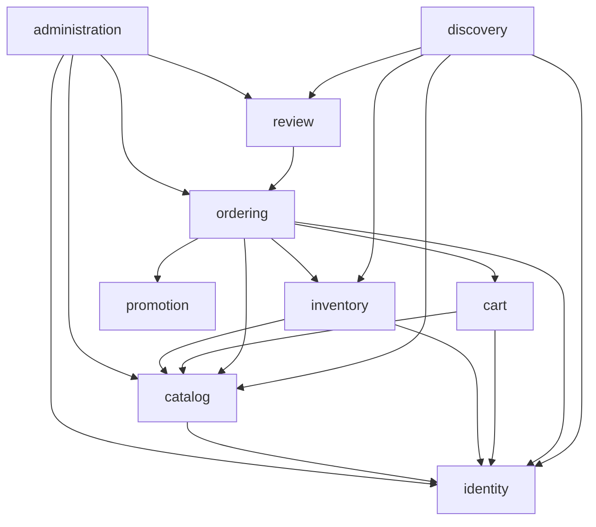

# Modular Monolith

Status: Approved implementation decision for [roadmap section 3](inkdrop://note/uUXxpSnh), revision 83, read through MCP on 2026-11-07. Java examples show implementation slices, not a compiled backend.

One Spring Boot process and one PostgreSQL database/schema own the REST HTTP/JSON backend. Gradle initially has one `:app` project; Spring Modulith boundaries are Java packages, not separate deployables. This keeps checkout atomic across modules (UC-04/05/07).

| Module | Responsibility / exported API | Allowed business dependencies |
| --- | --- | --- |
| identity | Account, address, Seller/shop eligibility; Actor and SellerFacts API | shared, audit |
| catalog | Product, Variant, Category, images; OfferFacts API | shared, identity, audit |
| inventory | Stock; decrement/restore/owner-update API | shared, catalog, identity |
| cart | Guest/Member intent and merge API | shared, catalog, identity |
| promotion | Voucher evaluation and redemption API | shared |
| ordering | CustomerOrder and portions; place/cancel/record COD; paid-purchase query API | shared, identity, catalog, inventory, cart, promotion, audit |
| review | Review creation, moderation and public summary API | shared, ordering, audit |
| discovery | Read-only composition for public and owned Seller product/category/review responses | shared, catalog, inventory, review, identity |
| administration | Admin command facade and bounded reports | shared, identity, catalog, ordering, review, audit |
| notification | In-app message persistence; triggers await BA decisions | shared |
| audit | Append/read audit records; no business callbacks | shared |
| shared | Immutable Money/IDs and small technical contracts | none |

`discovery` is an application composition module, not a new bounded context. It resolves the cycle in the conceptual context map: Catalog must not import Reviews when Reviews imports Ordering and Ordering imports Catalog. Inventory owns stock writes and consumes Catalog ownership facts plus Identity SellerShop eligibility; Catalog does not import Inventory. API response composition belongs in Discovery or the owning interface facade. Identity must not import Cart. Login orchestration at the application composition boundary authenticates through Identity and invokes the exported Cart merge use case before returning the token. Cart owns the merge transaction. No separate HTTP merge endpoint is added.

Arrows mean allowed code dependency. Shared and Audit edges are omitted for readability but required by the table. Modules call exported interfaces synchronously; no HTTP loopback, Kafka, outbox or separate payment state. Every checkout collaborator joins the caller's transaction. Cross-module writes through foreign repositories are forbidden. Read composition uses exported query APIs; Discovery resolves a trusted Seller actor through Identity for owned product detail. A module's adapter may join foreign tables only for an explicitly documented immutable projection.

Exit gate: module verification reports no cycle/internal access; last-unit and cancel/payment integration races preserve BA invariants. See [Spring Modulith](./3.3-spring-modulith.md).

MapStruct converters belong to the consuming module’s adapter and use only exported immutable API facts. Generated mappers must not add reverse dependencies or turn Discovery composition into a Catalog/Review cycle. See [mapping review](./3.14-mapstruct.md).
