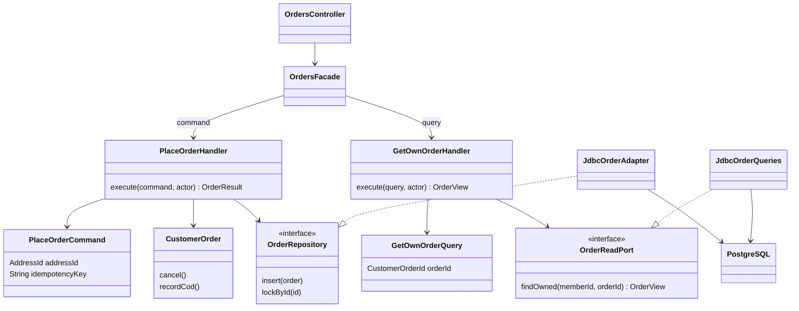

# CQRS

Status: Approved implementation decision for [roadmap section 3](inkdrop://note/uUXxpSnh), revision 83, read through MCP on 2026-11-07. Java examples show implementation slices, not a compiled backend.

Separate command handlers from query handlers in the same deployable and schema. Commands mutate roots inside transactions; queries return immutable owner-filtered projections (UC-01–UC-10). No event sourcing or asynchronously updated read database.

The facade maps HTTP input to an intent; it owns no transaction or persistence access. PlaceOrder first checks Member/key replay and then coordinates all required modules. GetOwnOrder requires Member identity in its SQL predicate; read-only does not mean public. Primary-database reads after commit observe the committed mutation. Database failure cannot yield a success result.

Acceptance: query interfaces contain no save operations; a duplicate checkout returns one order; read projections exclude foreign portions and hidden reviews. Contract fields come from [OpenAPI](../../api-contract/openapi.yaml); adding cursor parameters requires a reviewed contract update.

Command payload and query response mappings follow [MapStruct](./3.14-mapstruct.md). Query mapping exposes an allowlisted projection and does not authorize a read. Scenarios and automated tests must be written before a handler or mapper is implemented; use [section 4](../4-automated-testing/4.%20Automated%20Testing.md).
