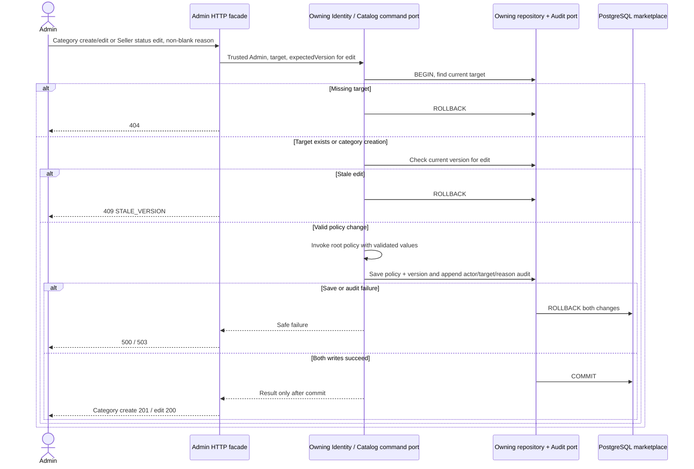

# Admin Policy, Reports and Audit

Approved design baseline: 2026-11-08. Implementation and test execution are tracked separately in the [backend backlog](../../../ProductManager/product-backlog.md).

UC-09/10. Operations: `createCategory`, `updateCategory`, `listSellersForPolicy`, `updateSellerStatus`, `getReport`, `listAuditEntries`. Review moderation follows [review sequences](./rating-review.md).

Seller status is ACTIVE or SUSPENDED. Suspension and checkout serialize through the same Seller eligibility row; already placed orders retain immutable snapshots and can complete COD. Lists supply target IDs/versions. Category selection uses `listCategories`; no additional Admin category-list endpoint is needed.

`getReport` and `listAuditEntries` pass Admin authorization, validate interval/cursor, invoke read-only JDBC projections and return 200. Report interval is UTC `[from,to)`, maximum 366 days. Metric definitions remain in OpenAPI. Audit is append/read only, cursor-scoped and never editable/deletable. Admin policy/report scope adds no payment correction, product moderation, notification or account-recovery endpoint.
