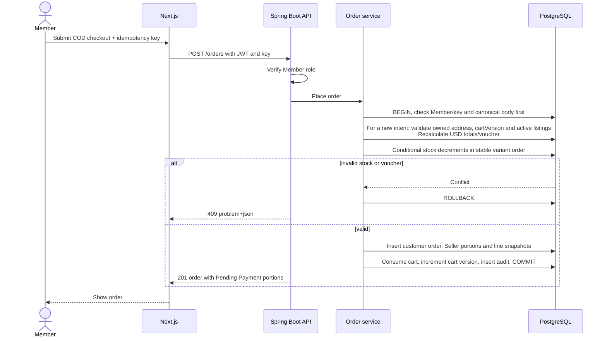

# COD Checkout Sequence

A repeated key with the same canonical body reconstructs the original creation response from immutable order snapshots before reading mutable cart/address/voucher state; a different payload returns 409. The diagram shows the new-intent branch. A new key with stale cartVersion also returns 409. An unauthenticated Guest cannot enter the transaction.
