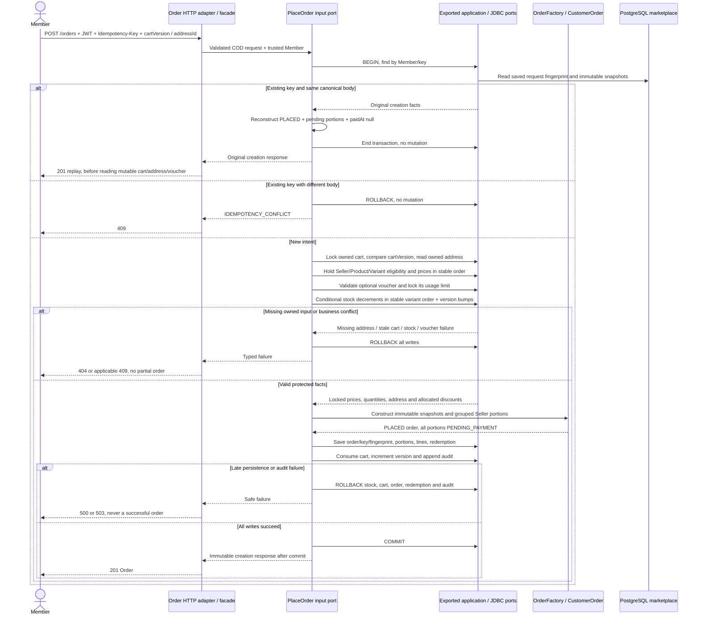

# Atomic COD Checkout and Replay

Approved design baseline: 2026-11-08. Implementation and test execution are tracked separately in the [backend backlog](../../../ProductManager/product-backlog.md).

UC-04; BR-01–07. Operation: `placeCodOrder`. The handler owns one transaction across exported Identity, Cart, Catalog, Inventory, Promotion and Audit ports; each JDBC adapter joins it. There is no event broker or separate payment service.

The canonical body contains addressId, cartVersion, optional voucherCode and paymentMethod; server totals/timestamps are excluded. Key scope is Member, retained while the order exists. Concurrent same-key requests must converge on the committed winner before treating a changed/consumed cart as a new-intent failure. Serialize the Member/key intent or recheck the winning record after the cart-lock wait; a unique-key loser rolls back fully and reads the winner in a fresh transaction. Different intent always returns 409. The implementation must test the exact chosen synchronization against real PostgreSQL.

Unknown commit outcome returns 503; retry with the same key/body. A new key needs the current cart version. No decrement-only retry is allowed. Zero configured vouchers is valid for the demo: absent code is no discount, any unknown code returns `VOUCHER_INVALID` and rolls back. This is not proof of implemented valid-voucher promotion behavior.
