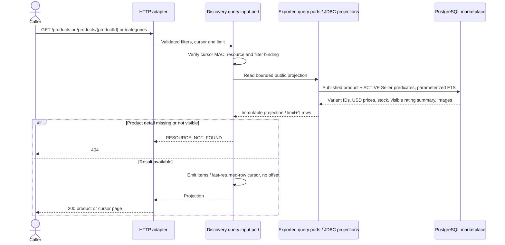

# Public Discovery and Scoped Queries

Approved design baseline: 2026-11-08. Implementation and test execution are tracked separately in the [backend backlog](../../../ProductManager/product-backlog.md).

UC-01 and supporting reads; BR-01/05/06. Operations: `listCategories`, `listProducts`, `getProduct`, `listOwnOrders`, `getOwnOrder`, `listOwnCheckoutAddresses`, `createOwnCheckoutAddress`.

## Public discovery

Category lists do not require a product match. Product filters use inclusive USD bounds and `simple` PostgreSQL FTS with immutable ID order. Empty lists are 200 with `hasNext=false`, `nextCursor=null`. Invalid or changed-filter cursors return 400. Response composition uses exported read ports; Catalog does not import Reviews.

## Checkout address and order reads

`createOwnCheckoutAddress` authenticates MEMBER, maps allowed address fields, creates an Address under the trusted Member in one transaction, and returns 201 after commit. It accepts no owner ID. `listOwnCheckoutAddresses` reads only that Member's addresses. This is UC-04 support, not profile editing.

`listOwnOrders` and `getOwnOrder` use the same read-only path with a Member predicate. Detail returns current state and immutable snapshots, including all portions of the Member's order. Foreign/missing detail returns 404. Order cursors use `(created_at,id)`; address/category/product cursors use ID. No query calls a command repository or changes data. These reads supply addresses before checkout and cancellation/payment state after commands.
