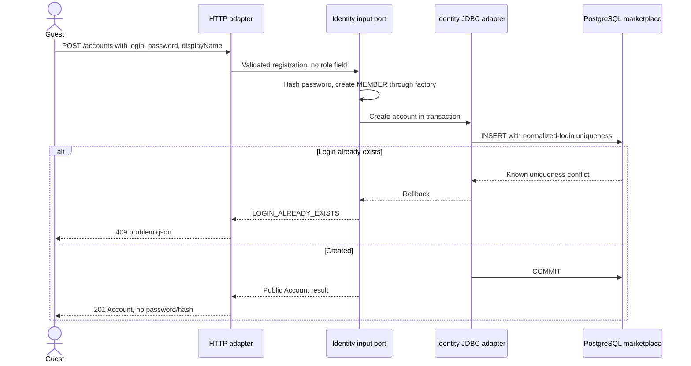
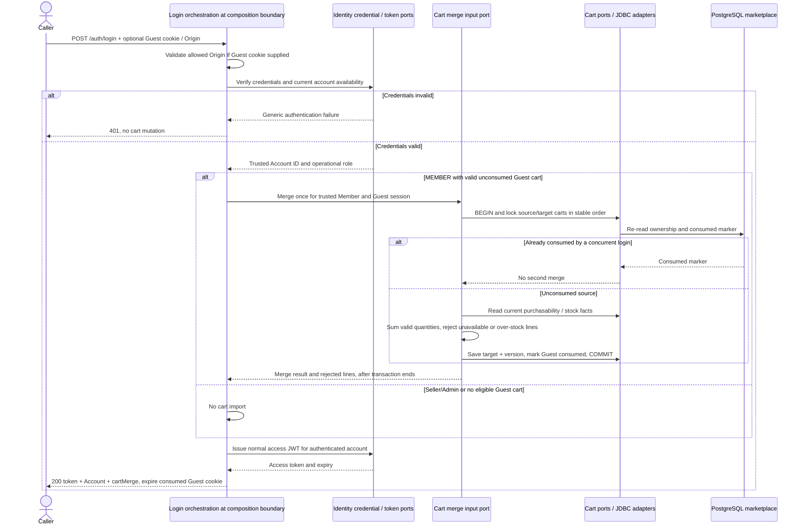
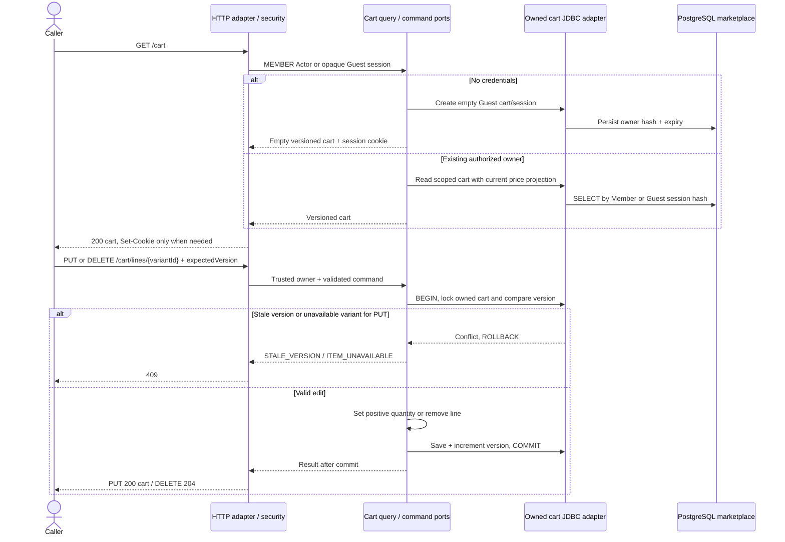

# Identity, Guest Merge and Cart

Approved design baseline: 2026-11-08. Implementation and test execution are tracked separately in the [backend backlog](../../../ProductManager/product-backlog.md).

UC-02/03; BR-05/06. Operations: `registerMember`, `logIn`, `getOwnCart`, `setCartLine`, `removeCartLine`. Cart commands never reserve stock.

## Registration and credential login

Seller/Admin accounts use controlled provisioning or guarded synthetic dev fixtures. Registration cannot assign their roles. Invalid fields return 400; deployment does not expose a production quick-login route.

## Login and exactly-once Guest consumption

Identity never imports Cart. The composition layer invokes exported input ports; Cart owns the merge transaction. A consumed source owned by another Member cannot be reassigned. Transaction failure returns an error, not a successful merge; retry cannot duplicate consumption. The no-op consumed branch ends its read transaction before returning. No `/cart/merge` HTTP operation exists.

## Get, set and remove cart lines

Seller/Admin cart access is 403. Invalid JWT never falls back to Guest. Cookie mutations require an allowed Origin. Missing owned resources return 404 before checking version. DELETE requires version in query; PUT requires it in JSON. Quantity and version syntax failures return 400.
