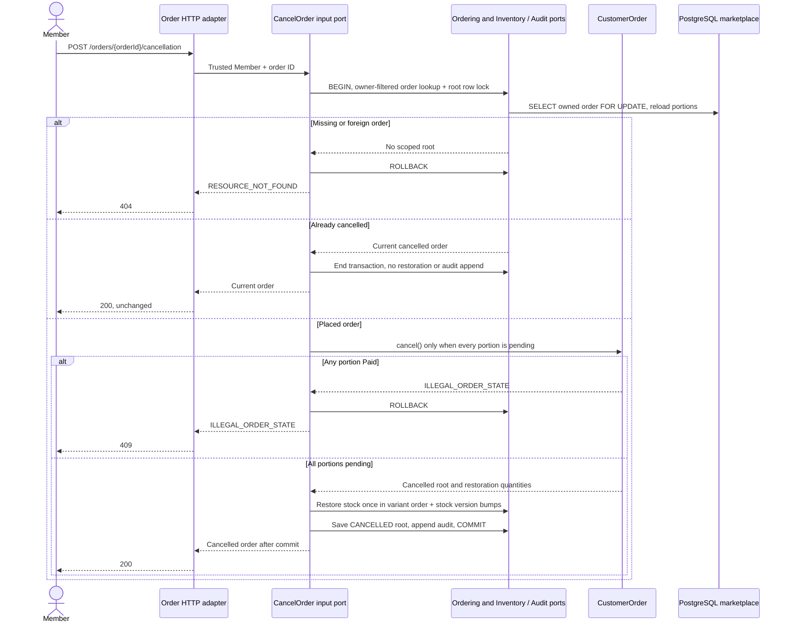

# Unpaid Order Cancellation

Approved design baseline: 2026-11-08. Implementation and test execution are tracked separately in the [backend backlog](../../../ProductManager/product-backlog.md).

UC-05; BR-03/06/09. Operation: `cancelUnpaidOrder`. The customer-order row is the same lock used by [mark-paid](./seller-payment.md).

Seller portion `status` is derived from the parent order; its stored payment status remains PENDING_PAYMENT on cancellation. Audit/stock/save failure rolls everything back. If payment wins the shared lock, cancellation fails; if cancellation wins, payment fails. Voucher quota restoration is not defined and is tracked in PB-012 before enabling configured vouchers. No refund/reverse-payment path exists.
