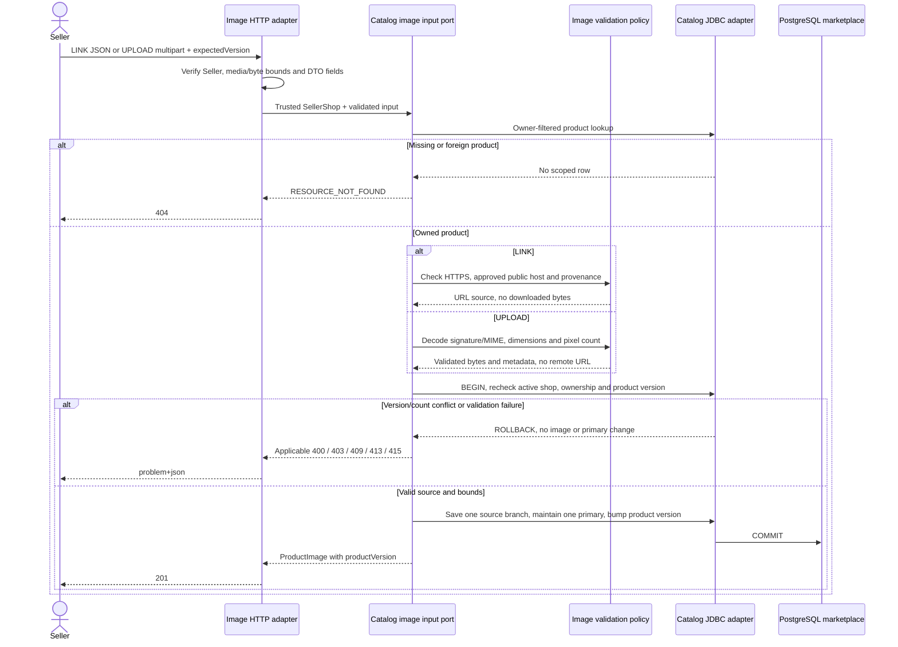
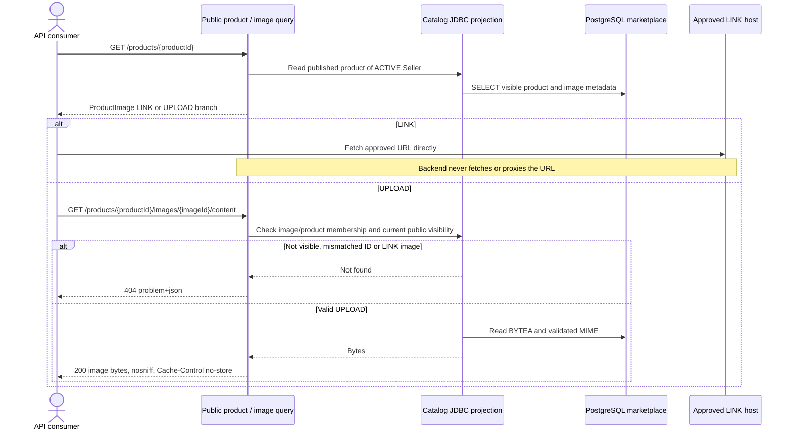

# Product Image Write and Read Sequences

Approved design baseline: 2026-11-08. Implementation and test execution are tracked separately in the [backend backlog](../../../ProductManager/product-backlog.md).

UC-01/06; BR-01/05/11. Operations: `addLinkedImage`, `uploadProductImage`, `removeOwnProductImage`, `getUploadedImage`. Exact limits and primary-image rules are in the [image contract](../../api-contract/product-images.md).

## Owned writes

Parser/type/size validation can reject before opening a transaction. `removeOwnProductImage` checks product/image membership and expected product version in one transaction, removes only the owned image, selects the next primary if needed, increments product version and returns 204. No remote deletion or storage service call occurs. Reload the owned product for its new version.

## Public display

Consumer placeholder behavior remains outside backend implementation. A display failure does not change product eligibility or stock. Approved host configuration is an explicit deployment input, not an arbitrary-URL download permission.
