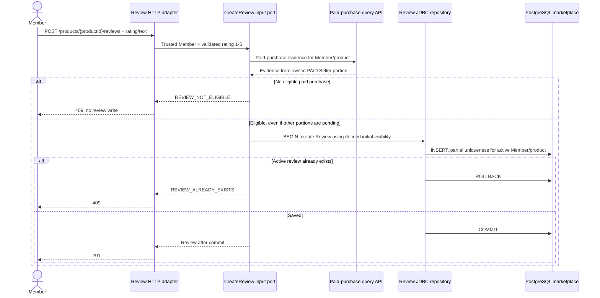
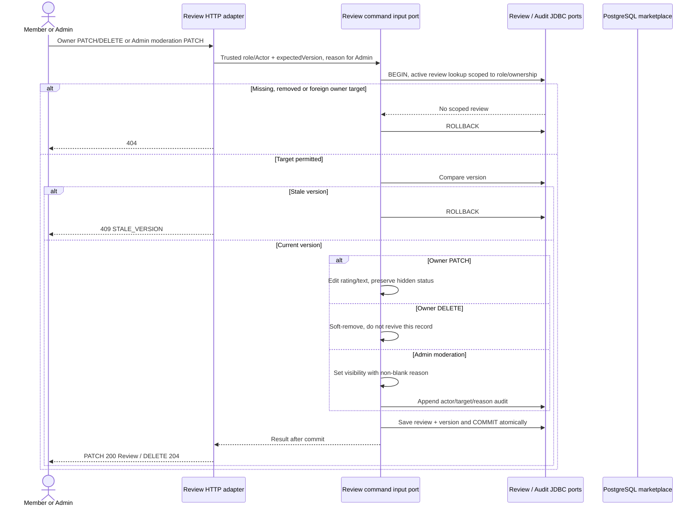

# Paid-Purchase Reviews and Moderation

Approved design baseline: 2026-11-08. Implementation and test execution are tracked separately in the [backend backlog](../../../ProductManager/product-backlog.md).

UC-01/08/10; BR-06/10. Operations: `listProductReviews`, `createProductReview`, `listOwnReviews`, `updateOwnReview`, `deleteOwnReview`, `listReviewsForModeration`, `moderateReview`.

## Create and read

PB-013 defines the missing initial-visibility value before its test-first gate; this diagram does not choose it silently. Missing public product is 404, invalid rating is 400; ineligible purchase is 409, not 403. Public review reads recheck product publication/Seller activity and filter visible, nonremoved reviews. Average/count cover all visible reviews, not one page. Own review reads include hidden active reviews; Admin reads include visible/hidden active reviews.

## Owner edits, removal and Admin moderation

Subsequent public summary reads use committed visible records; no asynchronous rating projection is required. Removal frees the active uniqueness slot for eligible resubmission as a new record; repeated removal is 404. Failed moderation audit rolls back visibility/version. No notification trigger is implied.
