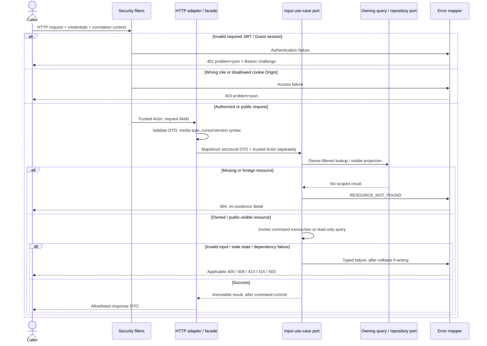

# HTTP, Security and Error Boundary

Approved design baseline: 2026-11-08. Implementation and test execution are tracked separately in the [backend backlog](../../../ProductManager/product-backlog.md).

All operations use this boundary. Role/ownership rules and the exact error-code subset come from [OpenAPI](../../api-contract/openapi.yaml); the [error class diagram](../../api-contract/exceptional-errors.md) defines rendering.

Validation failures can occur before the handler. Unexpected exceptions produce safe 500 responses. Security entry-point/access-denied handlers share the renderer with controller advice. Product and address creation have no existing resource owner lookup, but validate referenced category/address ownership where applicable. Domain classes contain neither HTTP status nor JWT parsing. For public reads, no credential is required; a supplied invalid credential is never an alternative route into a private API.
