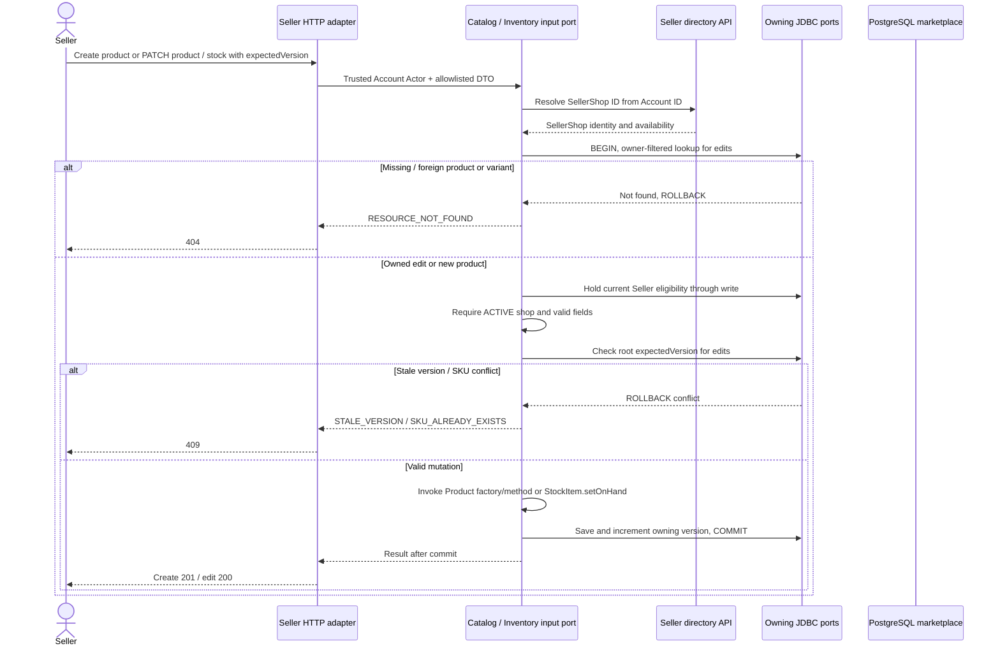

# Seller Catalog and Stock Edits

Approved design baseline: 2026-11-08. Implementation and test execution are tracked separately in the [backend backlog](../../../ProductManager/product-backlog.md).

UC-06; BR-01/02/03/05. Operations: `listOwnProducts`, `createOwnProduct`, `getOwnProduct`, `updateOwnProduct`, `updateOwnStock`.

Creation assigns IDs, requires at least one priced variant and initializes stock at zero. Product version guards publication, metadata, variant-price and image edits. Stock uses its own version, incremented also by checkout/cancellation. An absolute stale stock replacement is not automatically retried. Inactive Seller catalog writes return 403; unsafe/invalid input returns the operation's typed error.

Own list/detail reads use SellerShop ownership and include unpublished products and current versions, even while the shop is suspended. Public composition includes variants/stock without exposing foreign private records. PATCH omits unchanged fields; existing variant IDs must belong to the product, and omitted variants are retained. No catalog delete operation is added.
