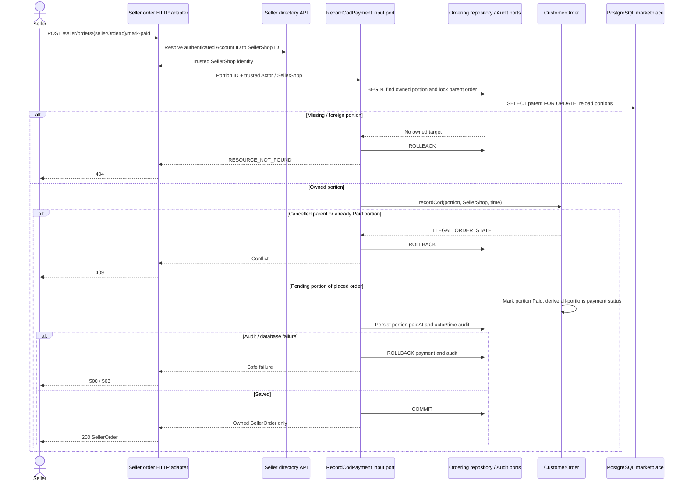

# Record Seller COD Cash Receipt

Approved design baseline: 2026-11-08. Implementation and test execution are tracked separately in the [backend backlog](../../../ProductManager/product-backlog.md).

UC-07; BR-05/08/09. Operations: `listOwnSellerOrders`, `markOwnOrderPaid`. CustomerOrder owns portion transitions; no independent SellerOrder write repository or payment module exists.

`listOwnSellerOrders` uses SellerShop ownership on every page and `(customer_order.created_at,seller_order.id)` cursor order. It never returns another Seller's lines or the Member's entire order. Aggregate payment is observable to the Member through `getOwnOrder`; mark-paid does not add an undeclared aggregate-status response field. Suspension blocks new sales/catalog writes, not recording cash for existing valid orders. Duplicate Paid is 409, not idempotent 200.
