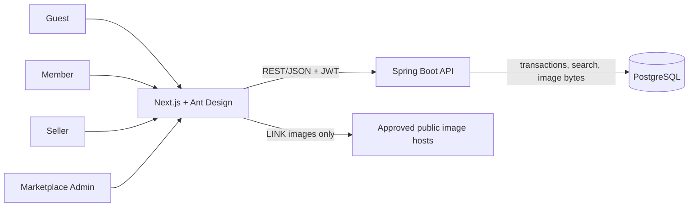

# System Overview

## System boundary

Browser → Next.js application → Spring Boot REST API → PostgreSQL for marketplace data. LINK product images are requested live from approved public image hosts by the browser. UPLOAD image bytes are stored and served from PostgreSQL. The browser may call same-origin Next.js routes/actions; only server code calls the Spring Boot API for private operations. Approved image hosts are the sole runtime external-source exception for LINK images. No broker, cache, search cluster, payment or delivery provider participates in ordering.

## Context and ownership

Next.js owns the browser experience, route protection and server-side API client. Spring Boot owns authentication, role and ownership checks, business rules, transaction boundaries and the OpenAPI contract. PostgreSQL owns marketplace records and UPLOAD bytes. Approved image hosts provide only LINK images; failure renders a placeholder and cannot block checkout. Physical COD handoff happens outside software; the Seller records receipt.

## Domain and deployment decisions

| Decision | Consequence |
| --- | --- |
| Four roles only | Guest, Member, Seller and Marketplace Admin; no staff, warehouse, support or provider actor |
| Member-only purchase | Guest cart can merge on login, but checkout requires JWT |
| COD and USD only | Seller portions transition Pending Payment → Paid; every price and snapshot uses USD |
| No shipping/return/refund | No endpoint, table, UI flow or system participant for those domains |
| One customer order, Seller portions | Seller sees and marks only own portion; aggregate Paid when all portions Paid |
| PostgreSQL as sole persistent data tier | Atomic stock, order, review and audit; Flyway migrations and backup/restore |
| Two product image modes | LINK is remote browser fetch with URL metadata; UPLOAD bytes are stored in PostgreSQL |
| Frontend monorepo | pnpm workspace, Next.js App Router, Ant Design; dev/prod profiles |
| Backend architecture | One deployable Spring Boot application; pragmatic Clean Architecture and DDD with small shared domain/core |

The deployment has a Next.js process, a Spring Boot process and PostgreSQL. HTTPS terminates at the application edge; production secrets are injected through deployment configuration. PostgreSQL backup/restore must include UPLOAD images. A database outage makes transactional operations unavailable; do not claim success for uncommitted work. The LINK image source is a separate availability dependency only for image display.

See [backend design](../backend/2-application-architecture/2.2-application-architecture/2.1.2-application-architecture.md), [frontend design](../frontend/frontend-design.md), [security](./security.md), [runtime profiles](./runtime-profiles.md) and [OpenAPI](../api-contract/index.md).

## Dependency disposition

| Keep when used | Remove or replace |
| --- | --- |
| Java 21, Spring Boot, Spring Security/JWT, validation, PostgreSQL driver, Flyway, Spring Boot Test, JUnit, AssertJ, Mockito, Testcontainers PostgreSQL; MapStruct, jMolecules, ArchUnit and Spring Modulith if they still give value | Kafka and Redis starters, Kafka Testcontainers, external-provider adapters and code that only serves them |
| Next.js, React, TypeScript, Zod, OpenAPI tooling, accessibility/testing tools and small pure UI helpers if needed | Radix UI, Tailwind packages, Redis client, Zustand, TanStack Query, Framer Motion, shadcn source and old design-token rules |
| Ant Design and pnpm workspace tooling | Old npm lockfile after the pnpm migration |

Do not remove unrelated dependencies merely to make the dependency list shorter. Do not retain unused code solely because it appeared in the former stack.
